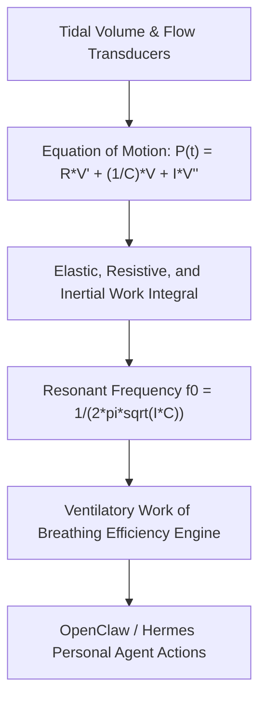

# Respiratory Inertance & Dynamic Compliance Skill

[](LICENSE)
[](https://www.python.org/)
[](requirements.txt)
[](mcp_server.py)
[](SKILL.md)

Zero-dependency sovereign personal agent skill for non-invasive evaluation of respiratory inertance (Irs), dynamic compliance (Cdyn), and mechanical Work of Breathing (WOB).



## Features
- **Deterministic Math**: Pure Python standard library implementation with zero external dependencies.
- **Biomechanical Respiratory Standards**: Implements validated physical equations of motion for gas-tissue interactions.
- **Work of Breathing Stratification**: Quantitative evaluation of mechanical energy dissipation per liter of air ventilated.
- **Model Context Protocol (MCP)**: Native JSON-RPC tool integration for LLMs and autonomous agents.

## Quickstart

```python
from client import RespiratoryInertanceComplianceClient

client = RespiratoryInertanceComplianceClient()
result = client.evaluate_respiratory_mechanics(
    dynamic_compliance_l_cmh2o=0.075,
    airway_resistance_cmh2o_s_l=2.40
)
print("Total WOB:", result["total_work_of_breathing_j_l"], "J/L")
print("Classification:", result["classification"])
```

## License
Apache-2.0
